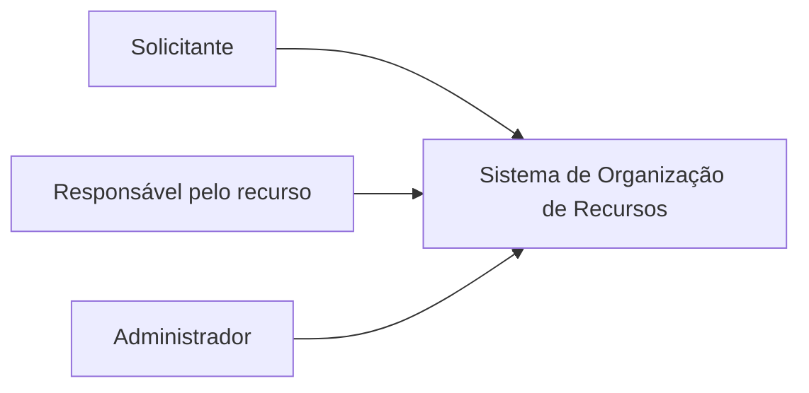
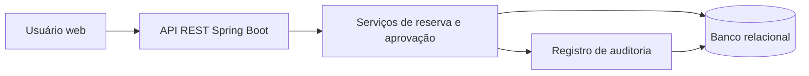

# Arquitetura proposta — Modelo C4 simplificado

## Contexto

## Contêineres

## Responsabilidades (proposta)
- API: validação de entrada, autenticação e autorização na borda.
- Serviços: regras de horário, conflito, fluxo de aprovação e manutenção.
- Banco: persistência transacional; mecanismos de exclusão de sobreposição precisam ser definidos segundo o SGBD.
- Auditoria: registro imutável ou controlado de mudanças de estado.

**Status:** diagrama conceitual, não comprovadamente implementado.
